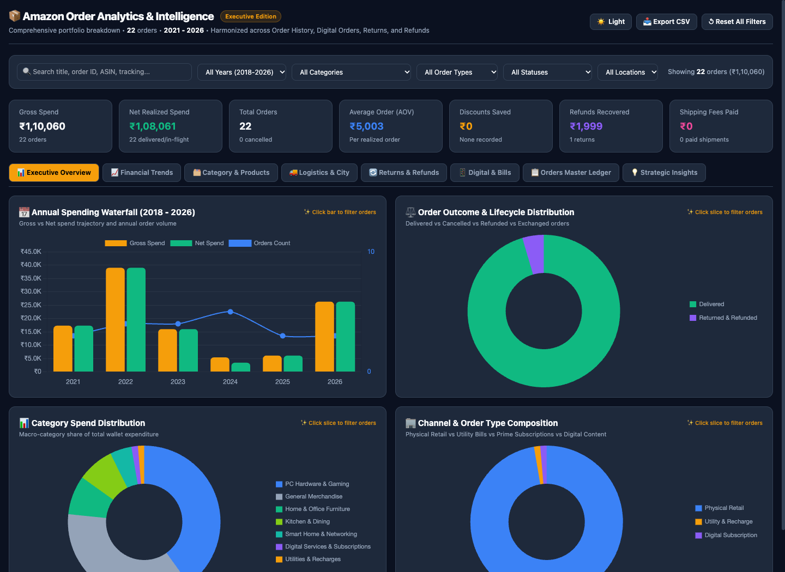

# 📦 Amazon Order Analytics Dashboard

A simple, private tool to visualize and explore your complete Amazon purchase history in a modern, interactive dashboard. **100% offline & local — your personal data never leaves your computer.**

---

## 📸 Preview



---

## ⚡ 1. Quick Start (Point & Click)

No coding or terminal knowledge required:

* **On Mac**: Double-click **`Run_Dashboard.command`** in Finder.
* **On Windows**: Double-click **`run.bat`** in File Explorer.
* **On Linux / Mac Terminal**: Run **`./run.sh`**.

The dashboard will open automatically in your web browser at:
👉 **`http://localhost:8000/dashboard.html`**

*(To test it right away without your own data, the app includes a preloaded sample dataset in `sample_data/`.)*

---

## 📥 2. How to Get Your Amazon Data

To visualize your own real Amazon order history, follow these 3 steps:

### Step A: Request your data from Amazon
1. Log in to your Amazon account.
2. Go to **Your Account** &rarr; scroll to **Data and Privacy** &rarr; click **Request Your Information** (or visit [amazon.in/privacy/data-request](https://www.amazon.in/privacy/data-request)).
3. Under *"Select the data you want to request"*, choose **Your Orders**.
4. Click **Submit Request**.

### Step B: Download the archive
* Amazon will email you when your archive is ready (usually takes between 30 minutes to a few hours).
* Click the download link in the email to download the `.zip` file.

### Step C: Place it in the folder
1. Extract / unzip the downloaded archive.
2. Move the extracted folder into this project and name it **`Your Orders`**:
   ```
   amazon_order_analysis/
   ├── Your Orders/                <--- 📂 Place your extracted Amazon data here!
   │   ├── Your Amazon Orders/
   │   │   ├── Order History.csv
   │   │   └── Digital Content Orders.csv
   │   └── Your Returns & Refunds/
   │       └── Returns Status.csv
   ├── Run_Dashboard.command       <--- Double-click to launch!
   └── run.bat
   ```
3. Double-click **`Run_Dashboard.command`** (Mac) or **`run.bat`** (Windows) to instantly update your dashboard!

---

## 🛠️ 3. Command-Line Options (For Developers)

If you prefer using the terminal with `uv` or Python:

```bash
# Generate dashboard and start local web server:
python main.py --serve

# Run on a custom folder:
python main.py --data-dir /path/to/orders/

# Run with demo fake data:
python main.py --data-dir sample_data/

# Inspect details of a specific Order ID:
python main.py --inspect "408-1234567-8901234"

# Run automated tests:
python -m unittest discover tests
```

---

## ✨ Features

* **Interactive Graph Filtering**: Click on any bar or pie slice (year, category, weekday, status) to instantly filter the orders table to that specific group.
* **Column Filters & Sorting**: Search by Order ID, item keyword, price tier, or delivery status directly from table headers.
* **Accurate Returns & Refunds Accounting**: Realized spend automatically excludes cancelled orders and subtracts refunded returns.
* **Universal Portability**: Automatically recognizes Amazon addresses and cities across India, the US, and internationally without hardcoding.
